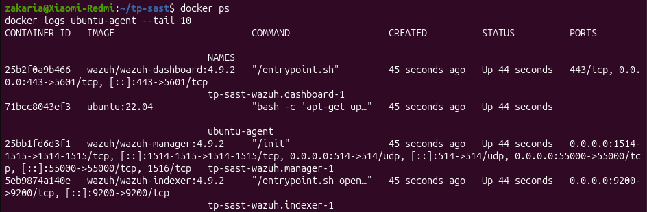
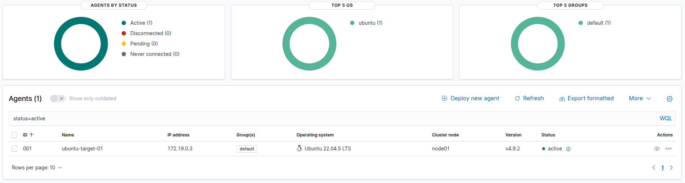
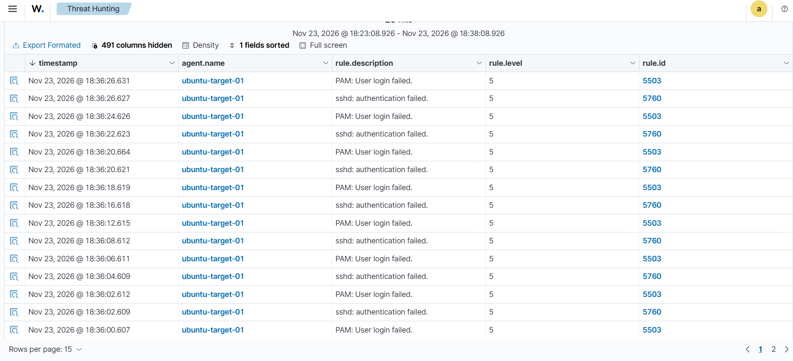
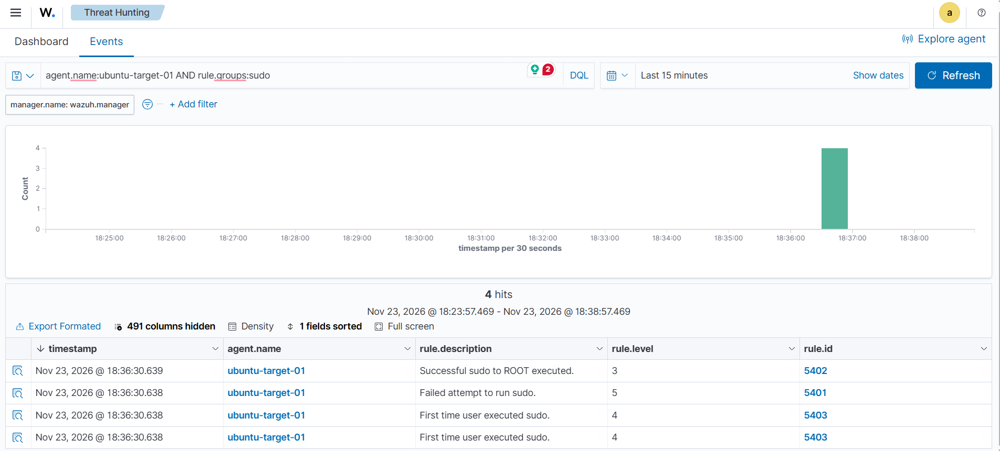
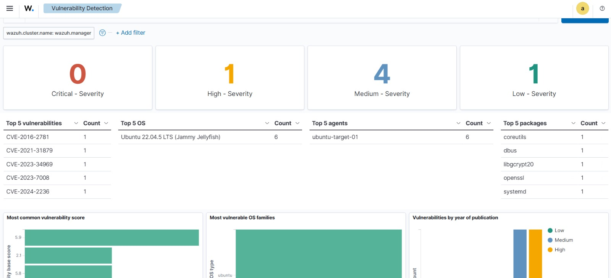
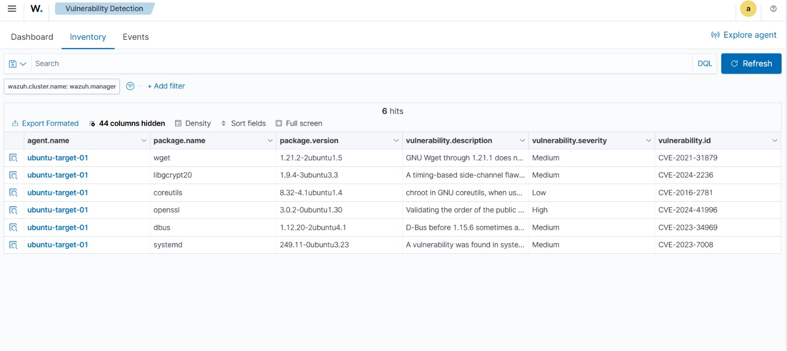
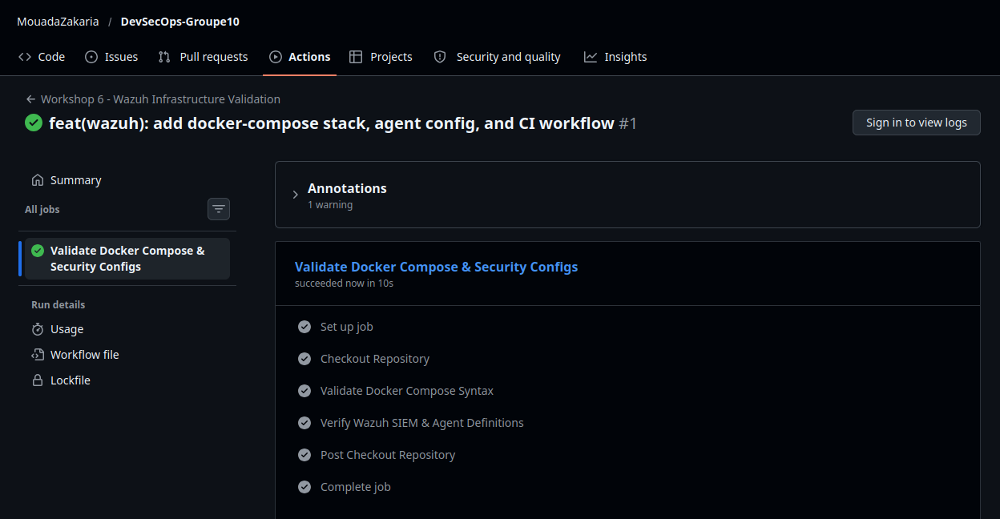

# Workshop 6 : Découverte de Wazuh (Supervision et détection des menaces)

**Projet :** DevSecOps, Groupe 10
**Branche :** `workshop6`
**Membres :** Zakaria Mouada, Zakaria Aribi, Jihane Diouri
**Chapitre :** 6, Monitoring, Logging et Réponse aux Incidents

---

## 1. Objectif du workshop

Ce workshop a pour but de découvrir et de manipuler **Wazuh**, une plateforme open source de supervision et de sécurité. Il s'articule autour de quatre axes :

1. déployer la solution avec **Docker** ;
2. configurer un **agent de supervision** sur une machine cible ;
3. **détecter des tentatives d'intrusion** (force brute SSH, élévation de privilèges) ;
4. **analyser les vulnérabilités** du système à travers les **CVE** identifiées.

L'objectif final est de se familiariser avec les outils et les pratiques de détection des menaces dans un environnement DevSecOps.

## 2. Répartition du travail

| Membre | Axe | Livrables |
|---|---|---|
| Zakaria Mouada | Déploiement Docker de Wazuh, enrôlement de l'agent, validation CI | `docker-compose.yml`, `.github/workflows/wazuh-ci.yml`, captures 01, 02, 06 |
| Zakaria Aribi | Détection d'intrusions (force brute SSH, élévation de privilèges) | `scripts/simulate_attacks.sh`, captures 03 et 04 |
| Jihane Diouri | Analyse des vulnérabilités CVE et rapport final | Captures 05 et 05b, ce `README.md` |

## 3. Architecture

| Composant | Rôle | Version |
|---|---|---|
| `wazuh.manager` | Reçoit et analyse les événements des agents | 4.9.2 |
| `wazuh.indexer` | Stocke et indexe les alertes | 4.9.2 |
| `wazuh.dashboard` | Interface web de visualisation (accessible sur `https://localhost`) | 4.9.2 |
| `ubuntu-agent` | Conteneur cible (Ubuntu 22.04.5 LTS) avec agent Wazuh 4.9.2-1 et accès SSH | 4.9.2-1 |

L'agent est enregistré dans Wazuh sous le nom **`ubuntu-target-01`**. Sa version est alignée sur celle du manager.

Les certificats SSL/TLS sont générés localement avec `generate-indexer-certs.yml`. Ils sont exclus du dépôt par le `.gitignore` afin de ne jamais publier de clés privées.

## 4. Déploiement de Wazuh et enrôlement de l'agent

Étapes réalisées :

1. Création de la branche `workshop6` et ajout d'un `.gitignore` excluant les certificats et clés.
2. Réglage du paramètre noyau `vm.max_map_count=262144`, requis par l'indexer.
3. Génération des certificats SSL/TLS : `docker compose -f generate-indexer-certs.yml run --rm generator`.
4. Lancement de la stack : `docker compose up -d`.
5. Déploiement du conteneur cible `ubuntu-agent` et enrôlement de l'agent, vérifié avec le statut **active**.

**Conteneurs en cours d'exécution**



**Agent Wazuh actif**



## 5. Détection des intrusions

Les attaques sont simulées contre le conteneur cible avec le script `scripts/simulate_attacks.sh`. Le script exécute deux scénarios :

- une série de connexions SSH avec de mauvais mots de passe (force brute) ;
- des commandes `sudo` en échec puis en réussite (élévation de privilèges).

Les alertes sont consultées dans le dashboard, rubrique **Threat Hunting**, filtrée sur l'agent `ubuntu-target-01`.

### 5.1 Attaque par force brute SSH

Des tentatives répétées d'authentification SSH échouées sont détectées par Wazuh et regroupées en alertes de force brute.



<!-- À COMPLÉTER avec Zakaria Aribi : identifiants et descriptions des règles visibles sur la capture 03. -->

| Règle Wazuh | Description | Niveau |
|---|---|---|
| *(à compléter d'après la capture 03)* | | |

### 5.2 Élévation de privilèges (sudo)

Les commandes `sudo` (échecs d'authentification, puis exécutions réussies sur des fichiers sensibles comme `/etc/shadow` ou `/etc/sudoers`) génèrent des alertes dédiées.



<!-- À COMPLÉTER avec Zakaria Aribi : identifiants et descriptions des règles visibles sur la capture 04. -->

| Règle Wazuh | Description | Niveau |
|---|---|---|
| *(à compléter d'après la capture 04)* | | |

## 6. Analyse des vulnérabilités (CVE)

Le module **Vulnerability Detection** de Wazuh compare l'inventaire des paquets de l'agent avec les bases de vulnérabilités connues. L'analyse porte sur l'agent `ubuntu-target-01` (Ubuntu 22.04.5 LTS, Jammy Jellyfish).

### 6.1 Vue d'ensemble



Six vulnérabilités sont détectées, toutes sur l'agent `ubuntu-target-01` :

| Sévérité | Nombre |
|---|---|
| Critical | 0 |
| High | 1 |
| Medium | 4 |
| Low | 1 |

Aucune vulnérabilité critique n'est présente. La vulnérabilité de sévérité haute concerne OpenSSL.

### 6.2 Détail des CVE



| CVE | Paquet | Version installée | Sévérité | Nature de la faille |
|---|---|---|---|---|
| CVE-2024-41996 | openssl | 3.0.2-0ubuntu1.30 | **High** | Validation coûteuse de clés publiques Diffie-Hellman, pouvant provoquer un déni de service |
| CVE-2021-31879 | wget | 1.21.2-2ubuntu1.5 | Medium | En-tête d'autorisation conservé lors d'une redirection vers une autre origine |
| CVE-2024-2236 | libgcrypt20 | 1.9.4-3ubuntu3.3 | Medium | Faille de type attaque temporelle (side-channel) sur le déchiffrement RSA |
| CVE-2023-34969 | dbus | 1.12.20-2ubuntu4.1 | Medium | Un utilisateur non privilégié peut provoquer le plantage du démon D-Bus (déni de service) |
| CVE-2023-7008 | systemd | 249.11-0ubuntu3.23 | Medium | Faille dans la résolution DNS de `systemd-resolved` |
| CVE-2016-2781 | coreutils | 8.32-4.1ubuntu1.4 | Low | Évasion possible d'un environnement `chroot` avec l'option `--userspec` |

### 6.3 Interprétation

- Les six vulnérabilités proviennent de **paquets système standard** de l'image Ubuntu 22.04, ce qui est cohérent avec l'utilisation d'une image de base non entièrement mise à jour.
- Le risque principal est le **déni de service** (OpenSSL, D-Bus) et la **fuite d'informations** (wget, libgcrypt20).
- Aucune CVE critique n'est exploitable à distance sans condition préalable, mais la CVE High d'OpenSSL doit être traitée en priorité, car OpenSSL est utilisé par de nombreux services, dont SSH.

## 7. Actions de remédiation

| Priorité | Action | Détail |
|---|---|---|
| 1 | Mettre à jour OpenSSL | Corriger la CVE High : `apt update && apt install --only-upgrade openssl libssl3` |
| 2 | Mettre à jour les paquets Medium | `wget`, `libgcrypt20`, `dbus`, `systemd` |
| 3 | Mettre à jour tous les paquets | `apt update && apt upgrade` |
| 4 | Reconstruire l'image Docker | Partir d'une base Ubuntu à jour plutôt que de corriger à chaud, afin que la correction soit reproductible |
| 5 | Scan en continu | Garder Wazuh Vulnerability Detection actif et ajouter une analyse d'image dans la CI |

Remarque : certaines CVE peuvent rester signalées si Ubuntu n'a pas publié de correctif pour la version 22.04. Il faut alors consulter le suivi de sécurité Ubuntu pour confirmer l'état de chaque CVE avant de la considérer comme corrigée.

Mesures complémentaires issues de la détection d'intrusions :

- **SSH** : désactiver la connexion root, imposer l'authentification par clé, limiter les tentatives (par exemple avec `fail2ban`) ;
- **sudo** : restreindre le fichier `sudoers` au strict nécessaire et surveiller les commandes privilégiées ;
- **Réponse automatique** : configurer l'Active Response de Wazuh pour bloquer les adresses IP à l'origine d'une force brute.

## 8. Intégration CI/CD

Un workflow GitHub Actions (`.github/workflows/wazuh-ci.yml`) valide automatiquement la configuration du déploiement Wazuh à chaque modification.



## 9. Conclusion

Ce workshop a permis de mettre en place une chaîne complète de supervision de sécurité : déploiement de Wazuh avec Docker, enrôlement d'un agent, détection de la force brute SSH et de l'élévation de privilèges, puis analyse des vulnérabilités CVE de la machine cible. La détection des intrusions et l'analyse des CVE sont complémentaires : la première observe les attaques en cours, la seconde réduit la surface d'attaque en identifiant les paquets à corriger. Ensemble, elles illustrent une démarche DevSecOps où la sécurité est surveillée en continu.

## 10. Structure du dépôt (branche workshop6)

```
.
├── README.md
├── docker-compose.yml
├── generate-indexer-certs.yml
├── config/
├── scripts/
│   └── simulate_attacks.sh
├── screenshots/
│   ├── 01_docker_containers_up.png
│   ├── 02_wazuh_agent_active.png
│   ├── 03_ssh_bruteforce_alerts.png
│   ├── 04_privilege_escalation_alerts.png
│   ├── 05_wazuh_cve_vulnerabilities.jpeg
│   ├── 05b_wazuh_cve_inventory.jpeg
│   └── 06_github_actions_wazuh.png
└── .github/workflows/wazuh-ci.yml
```
