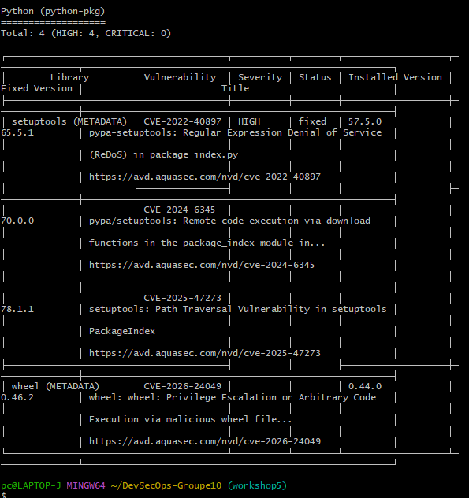
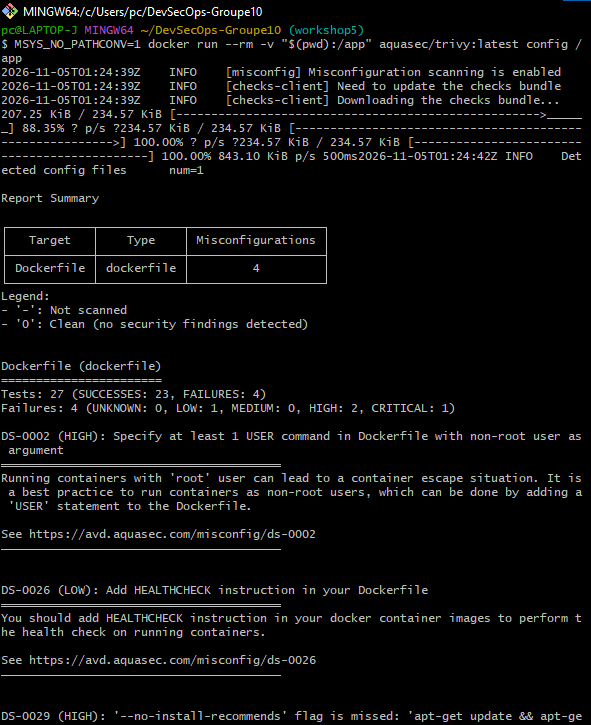
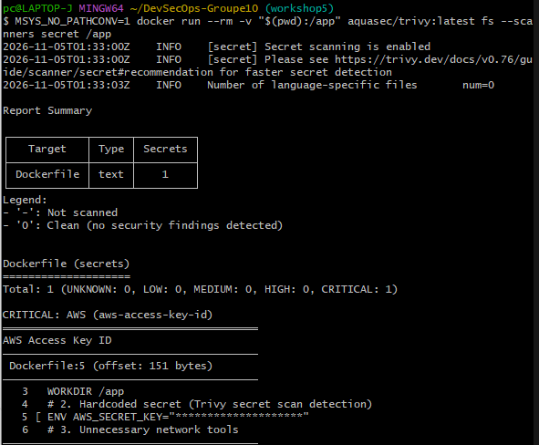
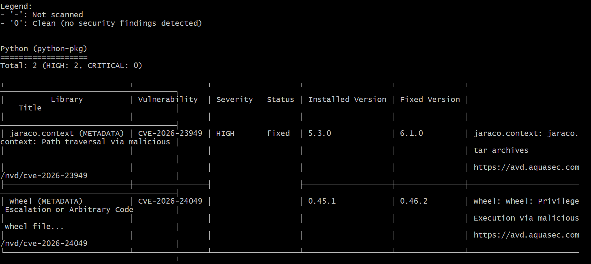
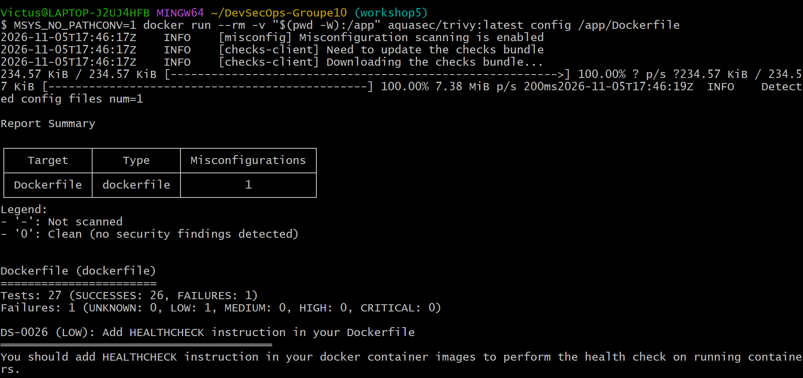
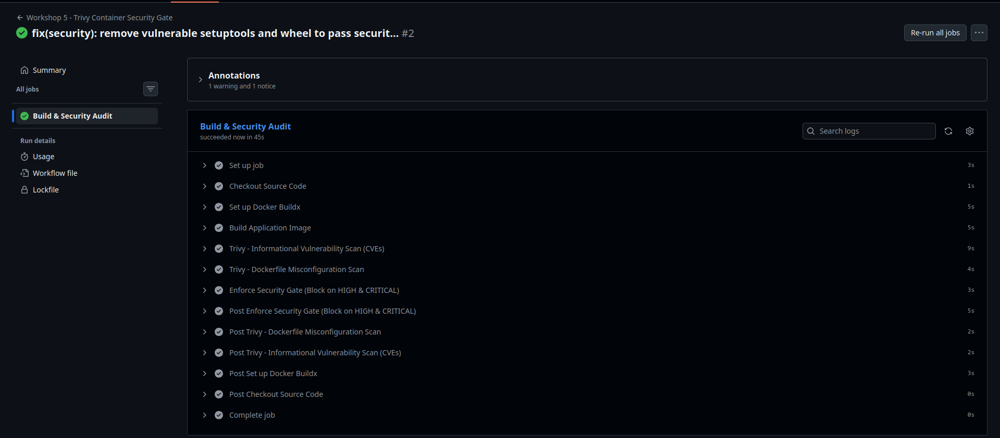

# Workshop 5 : Sécurisation des Images Docker avec Trivy

### Membres du Groupe 10
* **Zakaria Aribi** (Audit initial, détection des CVEs, secrets et mauvaises configurations)
* **Jihane Diouri** (Durcissement du Dockerfile, remédiation et réduction de surface d'attaque)
* **Zakaria Mouada** (Pipeline CI/CD DevSecOps, automatisation de la Security Gate et rapport)

---

## 1. Objectifs du Workshop
* Utiliser **Trivy** pour analyser une image Docker afin d’identifier les vulnérabilités (CVE), les mauvaises configurations et les secrets exposés.
* Interpréter les résultats du scan en se focalisant sur les sévérités **HIGH** et **CRITICAL**.
* Proposer et appliquer des actions de remédiation concrètes (mise à jour d'image de base, passage en utilisateur non-root, suppression des dépendances superflues).
* Intégrer Trivy dans un pipeline CI/CD GitHub Actions avec un seuil de blocage (*Security Gate*) automatisé.

---

## 2. Phase 1 : Audit Initial & Détection des Risques

### A. Scénario Vulnérable Initial
L'analyse initiale a été réalisée sur un conteneur basé sur une image non durcie (`python:3.8-slim`) présentant plusieurs risques de sécurité :
* Exécution sous les privilèges administrateur (`root`).
* Présence d'outils réseaux superflus (`curl`, `wget`, `net-tools`).
* Clés d'API exposées en clair dans les variables d'environnement.

### B. Résultats des Scans Trivy
1. **Scan des vulnérabilités de packages (CVEs HIGH & CRITICAL) :**
   

2. **Scan des mauvaises configurations (*Misconfigurations*) :**
   

3. **Détection des secrets exposés (*Secret Scanning*) :**
   

---

## 3. Phase 2 : Remédiation & Durcissement (Hardening)

Mesures de durcissement appliquées dans le `Dockerfile` :
1. **Migration vers une image minimale :** Utilisation de `python:3.11-alpine`.
2. **Utilisateur non-privilégié (*Non-root user*) :** Création et attribution de l'exécution à l'utilisateur système `appuser`.
3. **Réduction de la surface d'attaque :** Nettoyage des variables d'environnement sensibles et suppression des paquets d'outils de build (`setuptools`, `wheel`) contenant des CVEs élevées.

### Résultat du Scan après Durcissement :

---

## 4. Phase 3 : Intégration CI/CD & Security Gate

Pour bloquer automatiquement tout déploiement non sécurisé, un pipeline GitHub Actions a été configuré (`.github/workflows/trivy.yml`) :
* Déclenchement automatique à chaque `push` ou `pull_request` sur la branche `workshop5`.
* Compilation de l'image Docker à partir du code source.
* **Seuil de blocage (*Security Gate*) :** Échec immédiat du build (`exit-code: 1`) si des vulnérabilités de niveau **HIGH** ou **CRITICAL** sont détectées.

### Validation du Pipeline CI/CD :

